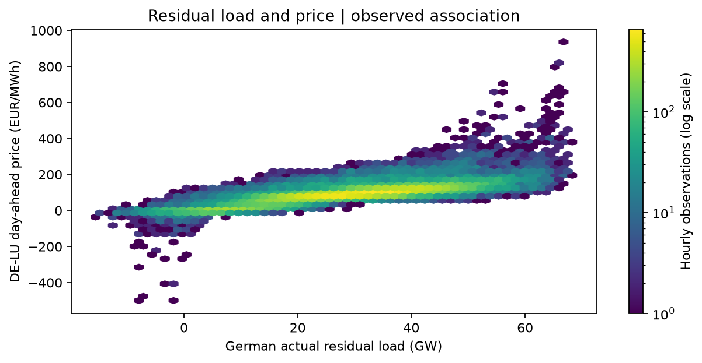
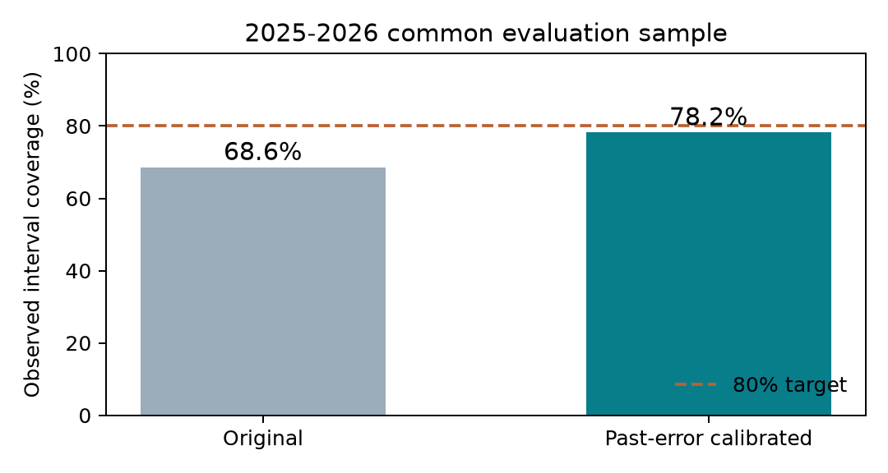
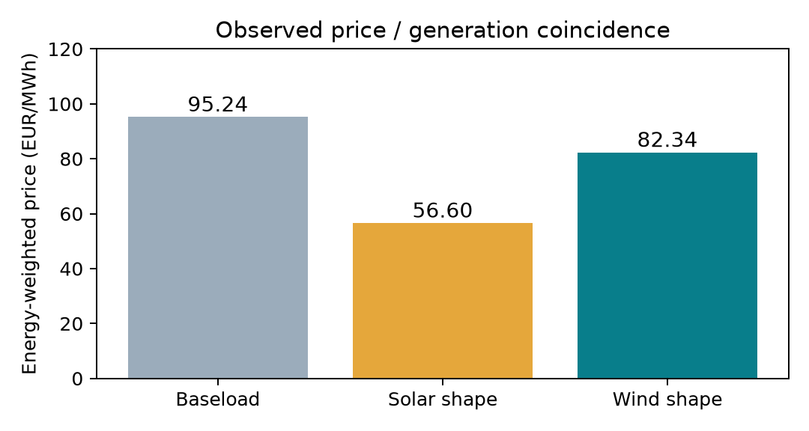

# European Power Market Volatility & Risk Analytics
### Germany case study: fundamentals, price tails and commercial exposure

**What drives German electricity price risk, what can be forecast, and what does it mean
for purchasers and renewable generators?** This reproducible Python project connects
actual demand, wind, solar, conventional generation and cross-border conditions to
DE-LU day-ahead prices, then tests probabilistic forecasts and hypothetical portfolios.
**Data budget: €0. Local execution. No invented market observations.**

**Observed period:** 1 January 2023–18 November 2026. **Source:** Bundesnetzagentur | SMARD.de.
63,843 native price intervals; 136,128 quarter-hours per core physical series; 34,032
complete hourly comparisons. Price and core physical series have no missing observations.

| Verified evidence | Commercial interpretation |
|---|---|
| Upper/lower residual-load quartiles: **€147.32 / €34.10 per MWh** | Average-price budgets conceal substantial conditional price differences. |
| High/low midday solar groups: **€21.34 / €109.39 per MWh** | Production-price coincidence matters for renewable revenue assumptions. |
| High/low demand groups: **7.48% / 0.42%** incidence of prices ≥€200/MWh | High-demand periods have disproportionate observed spike exposure. |
| Boosting 80% interval coverage: **68.6% → 78.2%** after past-error calibration | Reliability improves with wider intervals; probability calibration is not uniformly better. |

Physical comparisons are descriptive quartiles, not causal effects. Calibration figures
use the **same 16,488 evaluation hours from 2025 onward**. Detailed methods, sample sizes
and seven-day block confidence intervals accompany every finding.

[**Two-page executive report**](reports/executive_market_analysis.pdf) ·
[CV summary](docs/cv_project_summary.md) · [Interview preparation](docs/interview_preparation.md) ·
[Research notebooks](notebooks) · [Execution and limitations](docs/upgrade_execution.md)



## Research and business relevance

- **Price formation:** actual/forecast residual load, conditional distributions,
  calendar-controlled explanatory models, chronological holdout and permutation importance.
- **Volatility:** delivery-hour anomalies, rolling dispersion, negative/positive episodes,
  descriptive regimes and clustering diagnostics. Native quarter-hour analysis identifies
  **101 hours hiding a negative quarter** and **357 hiding a positive spike** in hourly means.
- **Forecast discipline:** seasonal benchmark, linear quantile regression and gradient
  boosting; walk-forward pinball/MAE, Brier/AP, reliability curves, coverage, width and
  hour/season breakdowns. Calibration uses earlier out-of-sample errors only.
- **Commercial risk:** hypothetical flat purchaser and national solar/wind-shaped
  exposures, interval-correct P&L, VaR/ES, seasonal/regime comparisons and capture prices.
  Solar capture is **€56.60/MWh**, wind **€82.34/MWh**, versus **€95.24/MWh** baseload.




## What is verified—and what is not

SMARD's official field catalogue identifies the data IDs, units and forecast categories.
Actual and day-ahead forecast load/onshore wind/offshore wind/solar are stored separately.
Other verified series include gas, coal, lignite, hydro, biomass, other generation,
French/Dutch prices, and French-border commercial exchanges and physical flows.
Nuclear has extensive gaps; French physical flows have 33 missing quarter-hours each.
Missing observations remain missing. Germany physical data are not identical to DE-LU zone totals.

**Fundamental-enhanced pre-auction forecasting remains blocked.** The retrieved forecast
snapshots lack original publication/vintage timestamps, and generation forecasts may
arrive after the D−1 11:00 Berlin cutoff. No actual delivery-day fundamental is used as a
prospective feature. The comparison file records the blocked model without invented metrics.
Price-only forecasts also remain exploratory because source revisions are not reconstructed.

The optional ENTSO-E connector is implemented but has not been live-tested with a token.
Open-Meteo coverage remains a three-location, one-week sample; weather is not used in
forecast models. Its hosted free tier is non-commercial. No paid fuels, curves, exchange
datasets or cloud services are required.

## Reproduce locally

Python 3.11+; run commands from the repository root. On Windows:

```powershell
python -m venv .venv
.\.venv\Scripts\Activate.ps1
python -m pip install -e '.[dev,presentation]'
$env:OMP_NUM_THREADS='2'
$env:OPENBLAS_NUM_THREADS='2'
power-risk audit --start 2023-01-01 --end 2026-11-19
power-risk fundamentals --start 2023-01-01 --end 2026-11-19
power-risk analyze
python -c "from power_risk.regimes.model import run; run()"
power-risk forecast --advanced
power-risk portfolio
python scripts/reproduce_upgrade.py
python scripts/build_showcase.py
python scripts/build_research_notebooks.py
python scripts/execute_notebooks.py
python -m streamlit run dashboards/app.py
```

On Linux/macOS use `source .venv/bin/activate` and
`export OMP_NUM_THREADS=2 OPENBLAS_NUM_THREADS=2`. Presentation dependencies are optional
for core calculations: install `.[dev]` to omit PDF/notebook authoring. A compatible
Windows Parquet fallback is available via `pip install -e '.[parquet-fallback]'`.
`requirements-lock.txt` records the actual environment, not a universal platform lock.

The first data retrieval downloads weekly provider responses. A shared request limiter,
retries and persistent hash-checked cache support repeat runs. Once downloaded, the
research/report workflow uses local files only. `scripts/reproduce_upgrade.py --download`
also retrieves/reuses fundamentals. `power-risk forecast` without `--advanced` is a
lightweight seasonal baseline and replaces the original model comparison with that subset.

```powershell
python -m pytest -q
python -m ruff check .
python scripts/dashboard_smoke.py
```

Dashboard pages: observed market overview; volatility/events/native intervals; fundamental
drivers; forecasting/calibration; commercial risk. Labels separate observed, modelled
and hypothetical results. Notebook and dashboard execution use local kernel sockets.

## Methods and contracts

Quarter-hour energy **MWh / 0.25 = MW**. Hourly physical means require four observed
quarters. Residual load = load − onshore wind − offshore wind − solar, with every component
present. UTC intervals preserve DST; local delivery dates drive day-level comparisons.
SMARD imports are negative in raw directional chart series: normalized imports are positive
into Germany; net import = import − export. Physical flows and commercial exchanges are separate.

2023 calibrates volatility-state thresholds; later state transitions are descriptive.
The original forecast experiment has 35 monthly folds. Enhanced calibration uses 2024
to initialize a rolling 90-day archive of past out-of-sample errors, with common evaluation
from 2025. Earlier evaluation months enter later calibration windows only after they are
known. Interval expansion never uses the current test month's labels. Seven-day moving
block bootstrap (500 fixed-seed draws) addresses some serial dependence, not structural breaks.

Generator P&L = (spot − reference) × MW × hours; purchaser reverses sign. Loss = −P&L.
VaR is an empirical loss quantile; ES integrates the worst tail with fractional mass.
Renewable profiles are German aggregate shapes normalized to 1 MW **observed peak**, not
plant capacity factors. Capture price = Σ(price × MWh)/ΣMWh. Scenarios are complete local
days, including 23/25-hour DST days. No real trading profits or optimal hedge claims.

## Evidence, source terms and project status

- [Quantified findings](reports/quantified_market_findings.csv), [driver research](reports/fundamental_driver_analysis.html),
  [data quality](reports/fundamental_data_quality.csv), [official field catalogue](reports/smard_field_catalog.json).
- [Enhanced forecasts](reports/model_comparison_enhanced.csv), [calibration windows](reports/calibration_windows.csv),
  [fundamental forecast status](reports/price_only_vs_fundamental.csv), [portfolio cases](reports/portfolio_risk_enhanced.csv).
- [Source access and terms](docs/data_sources.md), [data contracts](docs/data_contracts.md),
  [baseline audit](reports/repository_improvement_audit.md), [upgrade execution record](docs/upgrade_execution.md).

Original price and forecast reports remain as the baseline. Enhanced outputs have distinct
filenames, except the formerly unavailable fundamental report, which now contains real analysis.
Seven notebooks include questions, methods, actual charts, quantitative interpretation and limitations.
Tests cover ingestion failures, cache integrity, missing/duplicate timestamps, DST, MTU changes,
residual load, publication eligibility, direction, calibration separation, P&L and capture prices.

Code is MIT-licensed; source data retain provider terms. Attribution: **Bundesnetzagentur |
SMARD.de**. SMARD's current terms flag an ongoing wholesale-price licensing review. Raw
and processed observations, credentials and the local environment are excluded from Git;
analytical reports and figures are included. Recheck provider terms for a commercial reuse.
No causal, guaranteed-calibration, executable-strategy or professional trading-experience claim is made.
